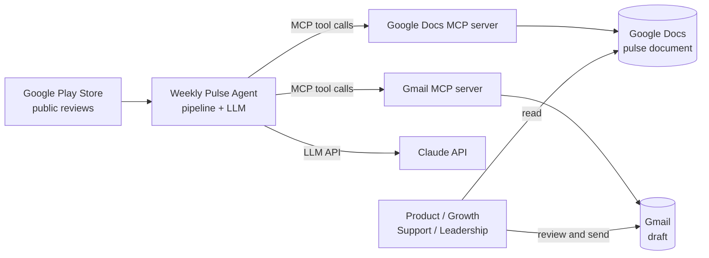
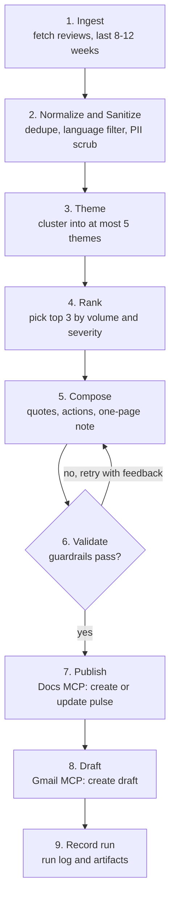
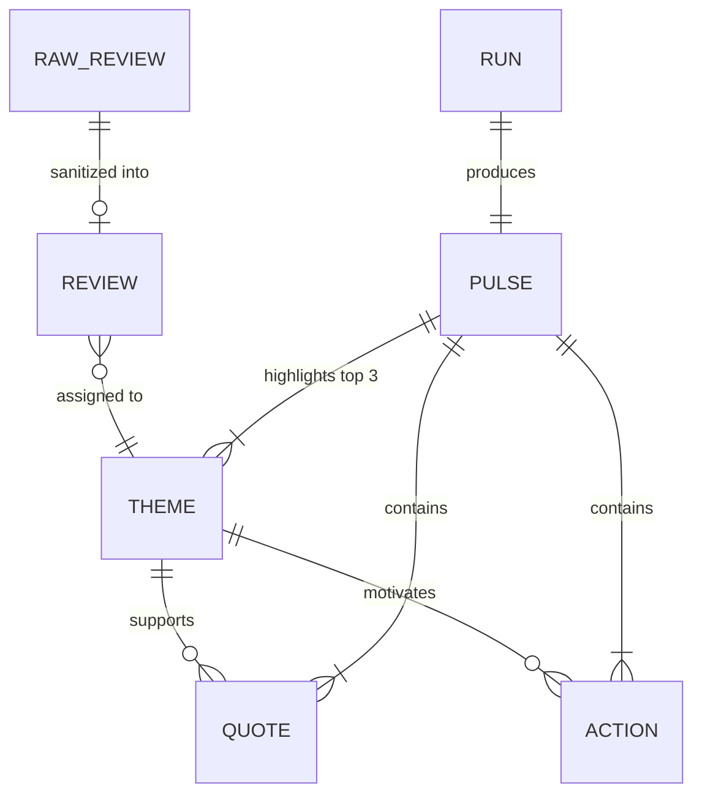
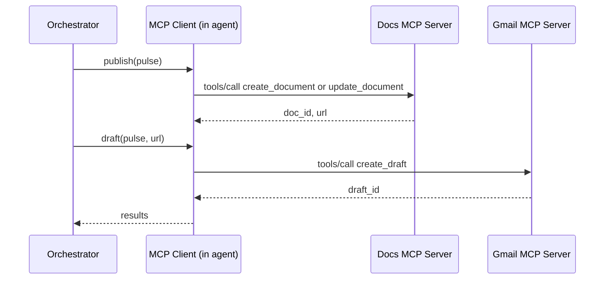

# Architecture: Groww Weekly Review Pulse

This document describes the design of the Groww Weekly Review Pulse agent. Requirements come from [problemStatement.md](problemStatement.md). Where the problem statement leaves a choice open, the choice is marked **Decision** or **Open question**.

## 1. Goals and Non-Goals

### Goals

- Turn 8-12 weeks of public Groww app reviews from the **Google Play Store** into a **one-page weekly pulse** (≤ 250 words) with top 3 themes, 3 verbatim quotes, and 3 action ideas.
- Publish the pulse to **Google Docs** and create a **Gmail draft** containing or linking to it, both through **MCP servers**.
- Guarantee the hard constraints (max 5 themes, verbatim quotes, no PII, word limit) with **code-level checks**, not only prompt instructions.
- Be re-runnable every week without duplicating documents or drafts.

### Non-Goals

- No direct Google API / OAuth / REST client code.
- No scraping behind store logins, no ToS-violating automation.
- No sending email automatically. The output is a **draft** only.
- No real-time dashboards or historical analytics UI.
- **No Apple App Store reviews for now.** The original brief mentions both stores; the App Store is deferred. The `ReviewSource` interface (4.1) means adding it later is a small, isolated change.

## 2. System Context



The agent is the only component we build. Everything else is an external service reached through a defined interface:

| External system | Interface | Auth handled by |
| --- | --- | --- |
| Play Store reviews | Public export (see 4.1) | None (public data) |
| Claude API | HTTPS SDK | API key in environment |
| Google Docs | MCP server tools | MCP server (OAuth lives there) |
| Gmail | MCP server tools | MCP server (OAuth lives there) |

## 3. High-Level Pipeline

The workflow is a **deterministic pipeline with LLM steps inside it**, not a free-roaming agent. Each stage has typed input and output, so it can be tested and evaluated on its own. The orchestrator owns control flow; the LLM only fills in bounded tasks (theme labeling, summarizing, drafting).



| # | Stage | Input | Output | LLM? |
| --- | --- | --- | --- | --- |
| 1 | Ingest | app ids, date window | raw `Review[]` | No |
| 2 | Normalize and Sanitize | raw reviews | clean `Review[]` (no PII) | No (regex + rules) |
| 3 | Theme | clean reviews | `ThemeAssignment[]`, ≤ 5 `Theme` | Yes (+ embeddings optional) |
| 4 | Rank | themed reviews | top 3 `Theme` | No |
| 5 | Compose | top themes + their reviews | `Pulse` draft | Yes |
| 6 | Validate | `Pulse` draft | pass / list of violations | No (code checks) |
| 7 | Publish | validated `Pulse` | Google Doc URL | No (MCP) |
| 8 | Draft | `Pulse` + Doc URL | Gmail draft id | No (MCP) |
| 9 | Record | everything above | run record on disk | No |

## 4. Component Design

### 4.1 Review Ingestion

**Responsibility:** produce a list of public reviews from roughly the last 8-12 weeks (default 10) for the Groww app on the Google Play Store. The Apple App Store is out of scope for now.

**Source adapters** implement one interface so sources can be swapped without touching downstream code:

```python
class ReviewSource(Protocol):
    def fetch(self, since: date, until: date) -> list[RawReview]: ...
```

| Adapter | Source | Notes |
| --- | --- | --- |
| `PlayStoreSource` | Groww on Google Play (`com.nextbillion.groww`, `hl=en_IN`) | The only live source in scope. |
| `CsvSource` | A local CSV/JSON export | Fallback and test fixture path. Also the way to ingest a Play Console export. |

An `AppStoreSource` is **deferred**. Because every source returns the same `RawReview` shape, it can be added later without changing any downstream stage.

**Decision:** adapters sit behind the interface and the pipeline can run entirely from `CsvSource`. This keeps the constraint "public review exports only" enforceable: if a live fetch method is not acceptable, the same pipeline runs on an exported file with no code changes.

**Open question:** the exact live-fetch mechanism for the Play Store (public fetch vs. exported file) needs confirmation. The ToS position of any third-party Play Store fetching library should be checked before it is used. No login-gated access is allowed in any case.

**Behaviors:**

- Window: `since = today - WINDOW_WEEKS`, default 10 weeks, configurable within 8-12.
- Pagination and rate limiting with polite delays and bounded retries with backoff.
- Output normalized to `RawReview` immediately; store-specific fields do not leak past this layer.
- Raw responses are cached under `data/raw/<run_id>/` so a re-run does not refetch and results are reproducible.

### 4.2 Normalization and Sanitization

**Responsibility:** make reviews safe and clean before any LLM or artifact sees them. This is the **PII boundary**: nothing downstream receives reviewer identity.

Steps, in order:

1. **Drop identity fields at the schema level.** `RawReview` may carry `author_name`, `author_id`, and similar fields; the normalizer builds a new `Review` that has no field for them. PII removal by omission is stronger than PII removal by redaction.
2. **Scrub free text** (title and body) with deterministic patterns: emails, phone numbers, URLs, long digit runs (card, account, PAN-like, Aadhaar-like), and device or order identifiers. Matches are replaced with a placeholder such as `[redacted]`.
3. **Deduplicate** exact and near-duplicate reviews (normalized text hash).
4. **Filter** reviews with empty text or too few characters to carry signal.
5. **Language handling:** keep English (including Hinglish) by default; configurable.
6. **Assign a stable anonymous id** (`review_id` = hash of store + store review id + salt) used for traceability without exposing the original id.

**Decision:** an optional LLM-based PII check runs as a second line of defense inside Validate (4.6), but the primary control is deterministic scrubbing.

### 4.3 Theming (Clustering)

**Responsibility:** group reviews into **at most 5 themes**.

**Approach: LLM-assisted clustering with a closed taxonomy.**

1. Start from a **seed taxonomy** suited to a brokerage / investing app, for example: Onboarding and KYC, Payments and Withdrawals, Trading Experience and App Performance, Statements and Reports, Customer Support. The taxonomy is config, and the LLM may propose replacements if the data does not fit.
2. In batches, ask the LLM to **assign each review to exactly one theme** (or `other`), returning structured JSON validated against a schema.
3. A final consolidation step enforces the cap: if more than 5 labels exist, merge the closest ones. The cap is enforced **in code** after the LLM step (reject and re-ask, then deterministic merge of the smallest clusters as a last resort).
4. Each theme gets a short label and a one-line description.

**Alternative considered:** embeddings + k-means / HDBSCAN, then LLM labeling of clusters. This is more reproducible and scales to large volumes, but needs an embedding model and tuning for small review counts. It is kept as a pluggable `Clusterer` implementation. The default is the LLM-assisted taxonomy approach because the review volume for a weekly note is modest and labels need to be human-meaningful.

```python
class Clusterer(Protocol):
    def cluster(self, reviews: list[Review], max_themes: int = 5) -> list[ThemeAssignment]: ...
```

**Determinism:** temperature 0 for assignment, fixed batch ordering, and cached assignments keyed by `(review_id, taxonomy_hash)` so repeated runs do not flip a review between themes.

### 4.4 Ranking

**Responsibility:** choose the **top 3 themes** for the one-page note from the ≤ 5.

Score per theme (all computed in code):

```
score = w_volume * share_of_reviews_in_window
      + w_recency * share_of_reviews_in_last_2_weeks
      + w_severity * (1 - normalized_avg_rating)
```

- **Volume** answers "what people talk about most," as the problem statement asks.
- **Recency** weights the most recent weeks, which makes the pulse weekly rather than a static summary.
- **Severity** (low average rating) surfaces pain points over neutral chatter.

Weights are config. The ranking is explainable: the run record stores each theme's score components.

### 4.5 Composition

**Responsibility:** produce the `Pulse` object that becomes the document and the email body.

**Quote selection** is a two-part process so quotes are never invented:

1. **Candidate selection in code:** for each top theme, take reviews that are representative (high similarity to theme, moderate length, clear sentiment). Quotes are chosen from this candidate list only.
2. **LLM picks and trims:** the LLM selects which candidates to use and may choose a contiguous snippet of a candidate. It returns `{review_id, snippet}`.
3. **Verbatim check in code (see 4.6):** the snippet must appear in the sanitized source review text. If not, the quote is rejected.

**Quote set:** 3 quotes total, covering the top themes (ideally one per theme), with a mix of ratings where possible so the note is not one-sided.

**Action ideas:** 3 concrete next steps, each tied to a named theme and phrased as an owner-agnostic action ("Add an in-app status tracker for withdrawals"), not a generic suggestion. The prompt gives the model the theme, its review count, and its quotes, and asks for actions grounded only in that evidence.

**Output schema:**

```python
@dataclass
class Pulse:
    week_label: str            # e.g. "2026-W42"
    window_start: date
    window_end: date
    review_count: int
    themes: list[ThemeSummary] # exactly 3: name, one-line summary, review share
    quotes: list[Quote]        # exactly 3: text, theme, rating, review_id
    actions: list[Action]      # exactly 3: text, theme
```

**Rendering:** a deterministic template (not the LLM) turns `Pulse` into the Doc content and the email body. Layout is fixed so every week reads the same way:

```
Groww Weekly Review Pulse - 2026-W42 (Jul 28 - Oct 05)   [n reviews]

Top themes
1. <Theme> - <one line> (<x>% of reviews)
2. ...
3. ...

What users said
- "<verbatim quote>" (<rating> stars, <theme>)
- ...
- ...

Action ideas
1. <action> [<theme>]
2. ...
3. ...
```

### 4.6 Validation (Guardrails)

**Responsibility:** enforce every constraint from the problem statement in code. Composition cannot reach Publish unless Validate passes.

| Constraint (from problem statement) | Check | On failure |
| --- | --- | --- |
| At most 5 themes | `len(themes) <= 5` after clustering | Merge / re-ask (4.3) |
| Pulse highlights top 3 | `len(pulse.themes) == 3` | Retry compose |
| 3 quotes | `len(pulse.quotes) == 3` | Retry compose |
| 3 action ideas | `len(pulse.actions) == 3` | Retry compose |
| Quotes are verbatim | each snippet is a substring of the sanitized source review (whitespace and case-normalized) | Drop quote, re-pick |
| No invented wording | same as above, plus quote `review_id` exists in the dataset | Drop quote, re-pick |
| ≤ 250 words | word count of rendered note body | Retry compose with "shorten" feedback |
| No PII | regex scan of the final rendered text (emails, phones, long digit runs, URLs) plus a check that no author name from the raw data appears in it | Block publish, fail the run |
| Actions grounded in themes | each action's `theme` is one of the top 3 | Retry compose |

**Retry policy:** at most 2 compose retries, each carrying the specific violations back to the model. If it still fails, the run stops with status `failed_validation` and publishes nothing. A failed run is preferable to a non-compliant artifact.

**Word-limit note:** the 250 words apply to the note itself. The email wrapper (greeting, link) is kept to a few extra lines and counted separately in the run record.

### 4.7 Publishing via MCP (Google Docs)

**Responsibility:** put the pulse where stakeholders can read it.

The agent is an **MCP client**. It connects to a Google Docs MCP server and calls its tools; it contains no Google SDK and no OAuth code.

Logical operations the publisher needs (actual tool names depend on the chosen server and are mapped in config):

| Operation | Purpose |
| --- | --- |
| `create_document(title, content)` | First run for a given week |
| `update_document(doc_id, content)` | Re-run for the same week |
| `get_document(doc_id)` | Optional read-back for verification |

**Idempotency:** one document per ISO week, titled `Groww Weekly Pulse - <YYYY-Www>`. The run record stores `week_label -> doc_id`. A re-run for the same week **updates** that document instead of creating a duplicate. **Open question:** whether stakeholders prefer one rolling document with a new section per week; the publisher interface supports either, since it just needs the target `doc_id` and content.

**Verification:** after writing, the publisher reads the document back (when the server offers it) and checks that the three quotes and the word count survived formatting. A mismatch is logged as a warning in the run record.

### 4.8 Drafting via MCP (Gmail)

**Responsibility:** create a **draft** (never send) addressed to the user or an alias.

- Recipient comes from config (`DRAFT_TO`), defaulting to the user's own address.
- Subject: `Groww Weekly Review Pulse - <week_label>`.
- Body: the rendered note plus a link to the Google Doc. If the body would break the length goal, it falls back to the three themes plus the link ("a clear pointer to it" is acceptable per the problem statement).
- Only a Gmail "create draft" operation is used. The send operation is **not mapped** in the tool allowlist (see 7), so the agent cannot send email even by mistake.
- **Idempotency:** the run record stores the `draft_id` per week. A re-run updates the existing draft when the server supports it; otherwise it creates a new draft and marks the old id as superseded in the run record.

### 4.9 Orchestrator

**Responsibility:** run stages 1-9 in order, own retries and failure handling, and emit the run record.

- Implemented as a plain Python module (a function per stage plus a small runner), not a framework. A graph framework can be adopted later if branching grows; the stage interfaces above already map to graph nodes.
- Each stage reads and writes typed objects and persists its output under `data/runs/<run_id>/<stage>.json`. A run can **resume** from any stage using these files.
- Failures are classified: `retryable` (network, rate limit, MCP timeout) vs. `fatal` (validation failed, auth missing). Only retryable errors are retried, with bounded backoff.

### 4.10 Scheduling

The pipeline is a one-shot command (`python -m pulse run --week current`). Weekly cadence is provided by an external scheduler, not by the app: cron, Windows Task Scheduler, or a CI schedule. The command is idempotent per week (4.7, 4.8), so a duplicate trigger is safe.

## 5. Data Model



| Entity | Key fields | Contains PII? |
| --- | --- | --- |
| `RawReview` | store, store_review_id, author_*, rating, title, text, date, app_version | **Yes. Lives only in ingestion, never persisted beyond raw cache, never passed on.** |
| `Review` | review_id (anonymous), store, rating, title, text (scrubbed), date, app_version | No |
| `Theme` | theme_id, label, description | No |
| `ThemeAssignment` | review_id, theme_id | No |
| `Pulse` | week_label, window, review_count, themes[3], quotes[3], actions[3] | No |
| `Run` | run_id, status, stage timings, doc_id, draft_id, validation results, score components | No |

**Raw cache and PII:** the cached raw responses in `data/raw/` can contain reviewer names. That directory is git-ignored, excluded from any artifact, and never read by stages after ingestion. Alternatively the cache can store only the already-minimized fields; this is the preferred setting.

## 6. LLM Usage

| Task | Model class | Output format | Temperature |
| --- | --- | --- | --- |
| Theme assignment (batched) | Fast, low-cost (Haiku-class) | JSON validated by schema | 0 |
| Theme consolidation / labeling | Mid (Sonnet-class) | JSON | 0 |
| Quote pick + action ideas + summaries | Mid (Sonnet-class) | JSON validated by schema | 0-0.3 |
| Optional PII second-pass | Fast | JSON verdict | 0 |

Principles:

- **Structured output everywhere.** Every call returns JSON checked against a schema. Invalid output triggers a bounded retry.
- **Prompt inputs are the sanitized `Review` objects only.** Reviewer identity is never in the prompt because it never leaves ingestion.
- **Treat review text as untrusted data.** Reviews are user-generated and can contain instructions ("ignore previous instructions..."). Prompts wrap review text in delimiters and state that it is data; and since all outputs pass through deterministic validation and cannot trigger tool calls on their own, the blast radius of an injected review is a bad summary that Validate can reject, not an action.
- **Prompts are versioned files** under `prompts/`, and their version is recorded in each run.
- Model ids and parameters are config; no model name is hard-coded in pipeline logic.

## 7. MCP Integration Design



- **Transport and server choice** are configuration: the project lists the MCP servers to launch or connect to (command + args, or URL) in a config file. Any compliant Docs/Gmail MCP server that exposes the operations in 4.7 and 4.8 can be used. This satisfies "MCP-first, not call Google APIs manually."
- **Tool mapping layer:** a small adapter maps our logical operations (`create_document`, `create_draft`, etc.) to the real tool names and argument shapes of the chosen server. Swapping servers means editing the mapping, not the pipeline.
- **Allowlist:** the client may call only the mapped tools. Sending mail, deleting documents, and sharing changes are not in the allowlist.
- **Credentials:** OAuth consent and token storage live in the MCP servers. The agent holds no Google credentials. The only secret the agent holds is the Claude API key, read from the environment and never logged.
- **Failure handling:** MCP timeouts and transient errors are retried with backoff; auth errors are fatal and reported with a clear instruction to re-authorize the server.
- **Dry-run mode:** `--dry-run` renders the note to disk and skips both MCP calls, which is useful for development and evals.

## 8. Evaluation Strategy

The course track includes **Evals**, so evaluation is part of the design and not an afterthought. There are three layers.

### 8.1 Deterministic checks (run on every run, also in CI)

The guardrails in 4.6 double as eval assertions: theme count, exactly-3 counts, quote verbatim rate (must be 100%), word count, PII scan.

### 8.2 Golden-set evals (run on prompt or model changes)

A small **labeled fixture set** of review samples (anonymized, committed to `evals/fixtures/`) with expected properties:

| Eval | Metric | Target |
| --- | --- | --- |
| Theme assignment | Agreement with hand-labeled themes | ≥ agreed threshold (set after first baseline) |
| Theme cap | Runs with > 5 themes | 0 |
| Quote fidelity | Fraction of quotes found verbatim in the source | 100% |
| PII leakage | Seeded PII (fake emails, phones, names) found in output | 0 |
| Prompt-injection resistance | Seeded malicious review changes output structure or leaks instructions | No |
| Action groundedness | Each action traces to a top-3 theme and cites supporting evidence | Pass on rubric |
| Length | Notes over 250 words | 0 |

### 8.3 LLM-as-judge rubric (qualitative, advisory)

A separate judge prompt scores the pulse on: actionability of the ideas, faithfulness of the theme summaries to the underlying reviews, and scannability. Judge scores are tracked over time but are **advisory**; only the deterministic checks can fail a run.

## 9. Configuration and Secrets

Single config file (`config.yaml`) plus environment variables:

| Setting | Example | Notes |
| --- | --- | --- |
| `app.play_package` | `com.nextbillion.groww` | From the problem statement |
| `window_weeks` | `10` | Must be 8-12 |
| `max_themes` | `5` | Hard cap |
| `taxonomy` | list of seed themes | Optional |
| `ranking.weights` | volume / recency / severity | |
| `mcp.docs`, `mcp.gmail` | server command or URL + tool mapping | |
| `draft_to` | user address or alias | |
| `models.*` | model ids per task | |
| `ANTHROPIC_API_KEY` | env var only | Never in files |

## 10. Project Layout

```
Groww AI Agent/
├── docs/
│   ├── problemStatement.md
│   └── architecture.md
├── config.yaml
├── prompts/                  # versioned prompt files
│   ├── theme_assign.md
│   ├── compose.md
│   └── judge.md
├── src/pulse/
│   ├── cli.py                # entry point: run / dry-run / resume
│   ├── orchestrator.py       # stage runner, retries, run record
│   ├── models.py             # dataclasses / schemas
│   ├── sources/              # PlayStoreSource, CsvSource (App Store deferred)
│   ├── sanitize.py           # PII scrub, dedupe, filtering
│   ├── theming.py            # Clusterer implementations
│   ├── ranking.py
│   ├── compose.py            # quote + action generation, rendering
│   ├── validate.py           # all guardrails
│   ├── llm.py                # Claude client wrapper, schema validation
│   └── mcp/
│       ├── client.py         # MCP client + allowlist
│       ├── docs.py           # logical Docs operations
│       └── gmail.py          # logical Gmail operations
├── data/                     # git-ignored: raw cache and run records
├── evals/
│   ├── fixtures/
│   ├── test_deterministic.py
│   └── run_golden.py
└── tests/                    # unit tests per module
```

## 11. Cross-Cutting Concerns

**Privacy.** PII is removed by schema omission and scrubbing at the earliest stage (4.2), re-checked on the final text (4.6), and tested with seeded PII in evals (8.2). Reviewer names, ids, and emails never reach the LLM, the Doc, or the email.

**Observability.** Each run writes a `Run` record: stage timings, review counts at each stage (fetched, after dedupe, themed), per-theme scores, prompt versions, retry counts, validation outcomes, Doc id/URL, draft id. Structured logs go to stdout; no review text or secrets are logged above debug level.

**Reproducibility.** Cached raw data, temperature 0, cached theme assignments, and versioned prompts mean the same inputs give the same pulse in practice, and any difference is attributable to a recorded change.

**Cost.** Theme assignment dominates token use and is batched on the cheapest suitable model. Prompt caching applies to the shared taxonomy/instruction prefix. Weekly volume is small, so cost per run stays low.

**Error handling summary.**

| Failure | Behavior |
| --- | --- |
| Source unavailable / rate limited | Retry with backoff, then fail run; fall back to `CsvSource` if configured |
| Too few reviews in window | Run completes with a "low volume" notice in the pulse; does not invent content |
| LLM output invalid | Bounded retry, then fail the stage |
| Validation fails after retries | Run ends `failed_validation`, nothing published |
| Docs MCP fails | Retry; if still failing, save the note locally and skip the draft (no dangling pointer) |
| Gmail MCP fails after Doc succeeded | Doc stays, run ends `partial` with the Doc URL recorded for a retry of just stage 8 |

## 12. Risks and Mitigations

| Risk | Mitigation |
| --- | --- |
| Review access method conflicts with store ToS | `ReviewSource` abstraction + `CsvSource`; confirm the approach before enabling live fetch (4.1) |
| LLM paraphrases a quote | Substring verification against source text; rejected otherwise |
| PII slips through in review text | Deterministic scrub + final-text scan + seeded-PII evals |
| Prompt injection via review text | Data delimiters, structured outputs, no LLM-driven tool calls, validation gate |
| Theme drift week to week | Stable seed taxonomy and cached assignments; taxonomy hash recorded |
| MCP server tool names differ across servers | Tool-mapping adapter; allowlist |
| Duplicate Docs/drafts on re-runs | Per-week idempotency keys in the run record |
| Small review volume makes themes noisy | Minimum-volume threshold with explicit low-volume notice |

## 13. Decisions and Open Questions

**Decided (Phase 0):**

1. **Play Store access:** public fetch of the public reviews, rate-limited, behind `ReviewSource`. `CsvSource` remains the fallback.
2. **Document model:** one Google Doc per ISO week, titled `Groww Weekly Pulse - <YYYY-Www>`.
3. **Draft recipient:** `prachtitest09@gmail.com` (`draft_to` in `config.yaml`).

**Still open:**

4. **MCP servers:** the user has Docs and Gmail MCP servers available, but their names, launch commands, and tool names are not yet recorded. They fix the tool mapping in section 7 and must be filled into `mcp.docs` / `mcp.gmail` in `config.yaml`. No MCP servers are currently configured in this environment, so the Phase 0 smoke test is pending.
5. **Eval thresholds:** theme-agreement target to be set after the first labeled baseline.

## 14. Suggested Build Order

1. `models.py`, `sanitize.py`, and `validate.py` with unit tests (no network, locks in the constraints first).
2. `CsvSource` plus a small anonymized fixture set; end-to-end dry run through theming, ranking, compose, validate.
3. LLM wrapper and prompts; golden-set evals (8.2).
4. MCP client, allowlist, and the Docs publisher; then the Gmail drafter.
5. Live `PlayStoreSource` once the open question in section 13 is settled.
6. Scheduler wiring and run-record polish.
