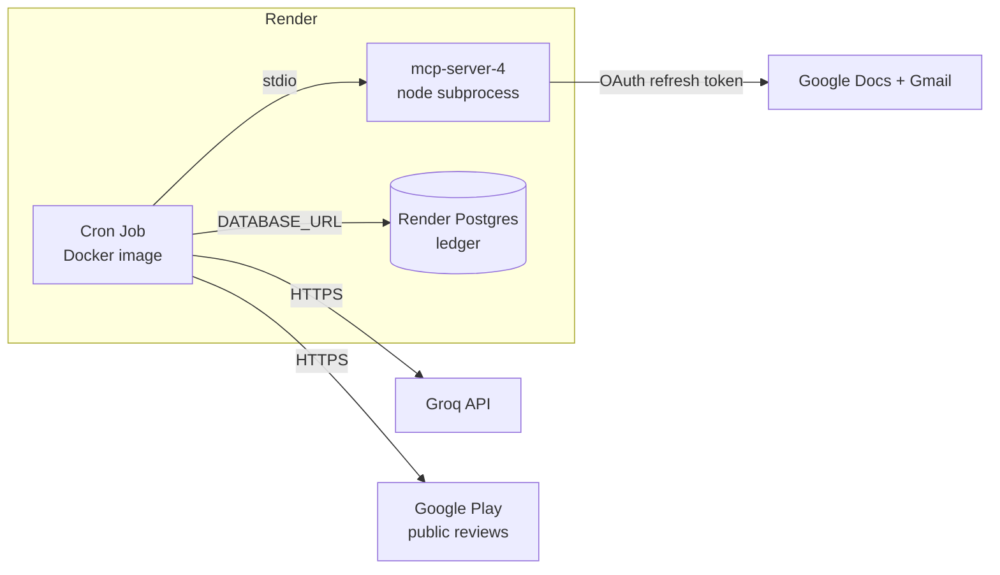

# Deployment Plan: Render

How to run the Groww Weekly Review Pulse unattended on [Render](https://render.com), once a week, without anyone's laptop. Read after [architecture.md](architecture.md) and [scheduling.md](scheduling.md); the build phases are in [implementation-plan.md](implementation-plan.md).

**Status:** plan only. Nothing here is built or deployed. Section 4 lists the code changes the deployment needs; they are a new Phase 8 after Phase 7's acceptance run.

## 1. Decision summary

| | |
| --- | --- |
| **Runs as** | One Render **Cron Job** (Docker), `30 3 * * 1-3` UTC, i.e. Monday to Wednesday 09:00 IST |
| **Why Monday-to-Wednesday** | Monday publishes. Tuesday and Wednesday are free retries: a published week ends as `already_published` in seconds with no fetch and no model call, so a failed Monday heals itself |
| **Ledger lives in** | **Render Postgres**, not a file. Cron jobs have no persistent disk, and the ledger is the only duplicate protection |
| **Google auth** | The MCP server's tokens arrive as the `GOOGLE_TOKENS_JSON` environment variable. No disk, no `npm run auth` on Render |
| **MCP server** | Built into the same image at the pinned commit, launched by our client over stdio, exactly as locally |
| **Secrets** | Render environment variables, never in the repo or the image |

The alternative, a Background Worker with a persistent disk and an in-process scheduler, is described in section 9 and not recommended.

## 2. What runs where



One container per run. The Python app starts the Node MCP server as a child process (the transport is stdio), so Python, Node and the built server must be in one image. The server is not deployed as a separate web service: our client speaks stdio only, and a public MCP endpoint holding Google credentials would be an extra attack surface for no benefit.

## 3. Platform facts that shape the plan

| Render behaviour | Consequence here |
| --- | --- |
| [Cron jobs cannot provision or access a persistent disk](https://render.com/docs/cronjobs); the container filesystem is discarded after each run | `data/ledger.json` cannot be the ledger. It moves to Postgres (D1). Run directories, the theme cache and the raw review cache are gone after each run |
| Raw reviews, which contain reviewer names, are written under `data/raw/` | On an ephemeral filesystem this is a privacy benefit: nothing survives the run |
| Cron expressions are evaluated in [UTC](https://render.com/docs/cronjobs) | 09:00 IST is 03:30 UTC. India has no daylight saving, so the schedule never shifts |
| If a run is still active at the next trigger, Render [delays the next run](https://render.com/articles/how-render-handles-scheduled-tasks) rather than overlapping | Overlap is unlikely, and the ledger's atomic claim (D1) protects the write anyway |
| A run is stopped after 12 hours | A normal run takes minutes (a live fetch measured 86 s) |
| [Free Postgres expires after 30 days](https://render.com/docs/free) | The ledger needs a paid database plan |
| The MCP Python SDK passes a child process only a small whitelist of environment variables (`PATH`, `HOME`, and similar) | `GOOGLE_CLIENT_ID` and the other variables set on Render would **not** reach the Node server. Needs a code change (D2) |
| Secret values set in the dashboard are available as environment variables at runtime; the [Blueprint](https://render.com/docs/blueprint-spec) can declare them with `sync: false` so values are entered in the dashboard, not committed | All secrets use this |
| Render deploys from a Git provider | This repo has **no Git remote** today. Push it to GitHub or GitLab first |

## 4. Code changes required (Phase 8)

Each item has an acceptance test and is built test-first like the earlier phases.

### D1. Ledger in Postgres, with an atomic claim
- Put the ledger behind an interface with two implementations: the current `FileLedger`, and `PostgresLedger`. `DATABASE_URL` set selects Postgres; unset keeps the file (local use unchanged).
- One table keyed by `(week_label, step)` holding `state`, `run_id`, details (`revision_id`, `draft_id`, ...) and timestamps.
- `mark_pending` becomes a single `INSERT ... ON CONFLICT DO NOTHING`: if it inserts nothing, someone else holds the step and the run stops. This also closes the one deferred minor from Phase 6 (two simultaneous starts).
- Store the week's `pulse` (JSON) and `note` with the doc step. Both are PII-free by construction. Reason: on Render the run directory is gone, so the "Doc section exists but the draft failed" retry (which today rebuilds the draft from `data/runs/<id>/note.txt`) must be able to rebuild it from the database instead.
- **Accept when:** the existing ledger contract tests pass unchanged against both backends; a second concurrent `mark_pending` loses; a partial week is completed by a fresh process with an empty `data/` directory.

### D2. Explicit environment for the MCP server
- Add `mcp.pass_env` to `config.yaml`: the allowlist of variables copied into the server's environment (`GOOGLE_CLIENT_ID`, `GOOGLE_CLIENT_SECRET`, `GOOGLE_REDIRECT_URI`, `GOOGLE_TOKENS_JSON`, `MCP_TRANSPORT`, `LOG_LEVEL`).
- Nothing else is forwarded. In particular `GROQ_API_KEY` and `DATABASE_URL` must **not** reach the Node process, and the Google secrets must not reach anything else.
- **Accept when:** a test launches a stub server and asserts it sees exactly the allowlisted variables.

### D3. Pre-publish privacy gate
- Run the existing audit (`pulse audit`) inside the orchestrator **between analysis and publishing**, with identities taken from the run's raw cache. Any finding ends the run as `failed` and publishes nothing.
- Today the audit is a manual command run after the fact; unattended, a leak would already be in the Doc.
- **Accept when:** a run whose note contains a seeded reviewer name publishes nothing and says why.

### D4. `check-deploy` preflight
- A read-only command: required variables present, Postgres reachable and schema current, `GOOGLE_TOKENS_JSON` parses, MCP server starts and lists both allowed tools (and still blocks `gmail_send_email`), Groq models available.
- Used as the first step of the container command, so a misconfigured deploy fails in seconds with a clear message instead of mid-run.

### D5. Container and blueprint
- `Dockerfile` and `render.yaml` as sketched in section 5.
- `data_dir` for Render is `/tmp/pulse-data` (config via an environment override, so local use is unchanged).
- Output goes to stdout only (Render keeps logs; run files are discarded). The CLI already prints stage timings, counts and the note.

### D6. What does *not* change
- The allowlist, the two MCP tools, `--dry-run` semantics, the exit codes, and the analysis pipeline.

## 5. Resources and configuration

### Image (sketch)

```dockerfile
# Stage 1: build the MCP server at the pinned commit (never a moving branch)
FROM node:22-slim AS mcp
RUN apt-get update && apt-get install -y --no-install-recommends git ca-certificates \
    && rm -rf /var/lib/apt/lists/*
WORKDIR /opt
RUN git clone https://github.com/saksham20189575/mcp-server-4 \
    && cd mcp-server-4 && git checkout 203fa75354fe7bd253534ca4703d8c0998414a7b \
    && npm ci && npm run build && npm prune --omit=dev

# Stage 2: the app, with the Node runtime copied from the same Debian family
FROM python:3.13-slim
COPY --from=mcp /usr/local/bin/node /usr/local/bin/node
COPY --from=mcp /opt/mcp-server-4 /opt/mcp-server-4
WORKDIR /app
COPY pyproject.toml ./
COPY src ./src
RUN pip install --no-cache-dir .
COPY config.yaml ./
COPY prompts ./prompts
ENV PULSE_DATA_DIR=/tmp/pulse-data PYTHONUNBUFFERED=1
CMD ["sh", "-c", "python -m pulse check-deploy && python -m pulse run --source play --week current"]
```

`config.yaml` in the image sets `mcp.server_dir: /opt/mcp-server-4`. The image contains no secrets and no `.env`.

### `render.yaml` (sketch, to be checked against the current [Blueprint spec](https://render.com/docs/blueprint-spec))

```yaml
databases:
  - name: pulse-ledger
    plan: basic-256mb        # a paid plan: the free one expires after 30 days
    region: singapore

services:
  - type: cron
    name: groww-weekly-pulse
    runtime: docker
    region: singapore
    schedule: "30 3 * * 1-3"            # UTC = 09:00 IST, Monday to Wednesday
    dockerCommand: >-                   # first deploy only: add --dry-run (section 7)
      sh -c "python -m pulse check-deploy && python -m pulse run --source play --week current"
    envVars:
      - key: DATABASE_URL
        fromDatabase: { name: pulse-ledger, property: connectionString }
      - { key: GROQ_API_KEY, sync: false }
      - { key: GOOGLE_CLIENT_ID, sync: false }
      - { key: GOOGLE_CLIENT_SECRET, sync: false }
      - { key: GOOGLE_REDIRECT_URI, value: "http://localhost:3000/oauth/callback" }
      - { key: GOOGLE_TOKENS_JSON, sync: false }
      - { key: MCP_TRANSPORT, value: stdio }
```

### Environment variables

| Variable | Set by | Goes to | Notes |
| --- | --- | --- | --- |
| `GROQ_API_KEY` | you, in the dashboard | Python app only | Never forwarded to Node (D2) |
| `DATABASE_URL` | Blueprint, from the database | Python app only | Use the internal URL |
| `GOOGLE_CLIENT_ID`, `GOOGLE_CLIENT_SECRET` | you | MCP server only | From the Google Cloud OAuth client |
| `GOOGLE_REDIRECT_URI` | Blueprint | MCP server only | Unused at runtime (no browser flow); keep the local value |
| `GOOGLE_TOKENS_JSON` | you | MCP server only | Contents of the server's `tokens.json` after a local `npm run auth` |
| `MCP_TRANSPORT` | Blueprint | MCP server only | Must be `stdio` |
| `PULSE_DATA_DIR` | Dockerfile | Python app | `/tmp/pulse-data` |

Not on Render, by design: the Google refresh token is the one long-lived credential. It is stored only as a secret environment variable, and `GOOGLE_TOKENS_JSON` makes the server refresh the short-lived access token in memory on every run. Nothing is written back.

## 6. Making Google authorisation last

The local setup uses a Google OAuth app in **Testing** status. For an unattended job that is a trap: [refresh tokens issued to a Testing app expire after 7 days](https://support.google.com/cloud/answer/15549945) when any scope beyond basic sign-in is requested, and this project requests `documents` and `gmail.compose`. The job would work for the first week and then fail with `GOOGLE_AUTH_REQUIRED` every week after.

1. In Google Cloud, set the OAuth consent screen's publishing status to **In production**. The 7-day limit applies to Testing only.
2. Because `documents` and `gmail.compose` are sensitive scopes, an unverified production app shows an "unverified app" warning at consent time and is capped at 100 users. For a single owner this is acceptable: you click through the warning once. Full verification is only needed to remove the warning or exceed 100 users.
3. Re-run `npm run auth` locally **after** publishing, so the refresh token is issued under the production app, and copy `tokens.json` into `GOOGLE_TOKENS_JSON`.
4. A refresh token is revoked if the account password changes (for some account types), the user revokes access, or it goes unused for about six months. A weekly job keeps it in use.

The runbook for an expired token is in section 8.

## 7. Rollout

Each step has a check; do not move on until it passes.

0. **Prerequisites.** Phase 7's acceptance run passed locally. Repo pushed to a Git remote. Google app published (section 6). Groq quota confirmed (a full run needs the theming and compose models; the live runs on 2026-10-22 hit the daily token limit on the theming model).
1. **Build the code changes D1 to D5** and merge. `pytest` green, including the Postgres contract tests.
2. **Create the stack from the Blueprint** with `dockerCommand` ending in `--dry-run`, and enter the secrets. Check: the build succeeds and the image runs `check-deploy`.
3. **Trigger the cron job manually** from the dashboard. Check in the logs: `check-deploy` passes; ingestion reached the start of the window from a Render IP (this is the largest unknown, see section 10); the run is `completed`; the note is under 250 words; nothing was written to the ledger table.
4. **Remove `--dry-run`, trigger once manually.** Check: one new section in the Doc, one draft in Gmail, `ledger` shows both done, no run reported `partial`. Trigger again: the log says `already published`, and the Doc and Drafts are unchanged.
5. **The schedule is now live.** It was in the Blueprint from step 2, so until step 4 scheduled runs were dry runs; from step 4 they publish. Watch the next Monday. Check the Tuesday and Wednesday runs end `already_published`.
6. **Two clean weeks** before treating it as done.

## 8. Operations

**Where to look.** Render's run history for the cron job (success or failure per run) and its logs. A failed run exits non-zero: 1 failed or `partial`, 2 bad arguments, 3 stopped for a manual ledger check. Check the service's notification settings so a failed run alerts you; the Tuesday and Wednesday retries only help if someone also learns Monday failed.

| Symptom in the log | Meaning | Action |
| --- | --- | --- |
| `GOOGLE_AUTH_REQUIRED` | Refresh token revoked or expired | Locally: `npm run auth`, copy the new `tokens.json` into `GOOGLE_TOKENS_JSON`, trigger the job. Nothing was written, so the rerun is safe |
| `DOC_PERMISSION_DENIED` | The authorised account lost edit access to the Doc | Share the Doc with that account; trigger the job |
| `Groq tokens-per-day limit reached` | Daily model quota | The Tuesday and Wednesday runs retry. If it persists, change the model for that task (needs a golden eval run first) |
| `Stopped: ... marked pending in the ledger` (exit 3) | A previous run died mid-write, outcome unknown | Check the Doc and Drafts, then `python -m pulse ledger confirm` or `clear` **from your machine** with `DATABASE_URL` set to the database's external connection URL (restrict it to your IP in Render) |
| `partial` | Doc section written, draft failed | Fix the cause (usually a Gmail error in the log) and trigger the job; it retries only the draft from the note stored in the ledger (D1) |
| `failed` before any Google call, ingestion errors | Google Play unreachable or blocking | See section 10; there is no CSV fallback on Render |
| Image build fails at `npm ci` | The pinned server commit or its dependencies changed | Do not move off the pinned commit casually; see below |

**Upgrading the MCP server.** The commit in the Dockerfile is pinned. To move it, change the commit, rebuild, run steps 2 and 3 of the rollout (dry run on Render), and run the Phase 5 integration test against the new build before trusting it.

**Rotating secrets.** Groq key: change the variable, trigger the job. Google client secret: rotate in Google Cloud, update `GOOGLE_CLIENT_SECRET`, then re-run `npm run auth` locally and update `GOOGLE_TOKENS_JSON` (tokens are tied to the client).

**Backups.** The ledger is the single piece of state. Enable the database's backups (a paid plan feature on Render, check the plan). Losing the ledger has the same effect as before: the next run of an already-published week would publish again.

## 9. Alternative considered: Background Worker with a persistent disk

Run one always-on worker with a disk mounted for `data/`, keep the file ledger, and add a scheduler loop to the app.

| | Cron Job + Postgres (chosen) | Background Worker + disk |
| --- | --- | --- |
| Scheduling | Render's, with run history and failure status | Ours: a new long-running loop to write and keep correct (missed runs, restarts, drift) |
| Cost shape | Billed for run time, plus the database | Always on, plus the disk |
| Ledger | Atomic claim in SQL | File with fsync; not safe against two instances |
| Code change | Larger (Postgres backend) | Smaller (scheduler loop) |
| Deploys during a run | No long-running process to restart | A deploy restarts the worker and can kill a run mid-write, leaving a `pending` step for a human |
| Disk | None, so the raw reviewer-name cache vanishes with the container | Raw cache and run records persist on disk and must be pruned |

The worker is less code but turns a stateless weekly job into a service to babysit. It stays the fallback if a managed Postgres is not wanted.

## 10. Risks and open questions

| Risk or question | Why it matters | Handling |
| --- | --- | --- |
| **Google Play may rate-limit or block datacenter IPs.** The fetch has only been run from a home connection (10,355 reviews, 52 pages, 86 s) | If Render's egress is blocked, there is no ingestion and no CSV fallback in the cloud | Rollout step 3 tests exactly this with `--dry-run` before anything is published. If blocked: a different Render region, a scheduled export dropped somewhere the job can read, or running the fetch elsewhere and passing a CSV |
| Unverified Google app (section 6) | A warning screen and a 100-user cap, not a functional limit for one owner | Accepted; verification only if the audience grows |
| Postgres is a new dependency and the one piece of state | Wrong ledger state means a missed or duplicated publish | Contract tests on both backends; backups; `ledger` commands for repair |
| Groq daily token quota | Observed twice on 2026-10-22, from heavy eval and live-run use | Mon-Wed retries; the weekly run itself is small (500 reviews sampled) |
| Cost | Not estimated here: Render and Groq prices change | Billable parts: cron job runtime, Postgres plan, build minutes, Groq tokens. Check current pricing before step 2 |
| Who owns the Git remote and Render account | Deploy needs a remote and an account | Open: decide before step 1 |
| Two-person access to secrets | `GOOGLE_TOKENS_JSON` grants Docs and Gmail-draft access to the account | Restrict Render team access; the allowlist still prevents sending mail even if the process is misused |

## 11. Out of scope

Multiple apps or Docs, App Store reviews (still deferred), a web UI, and any change to what the note contains. Those are product changes, not deployment.
