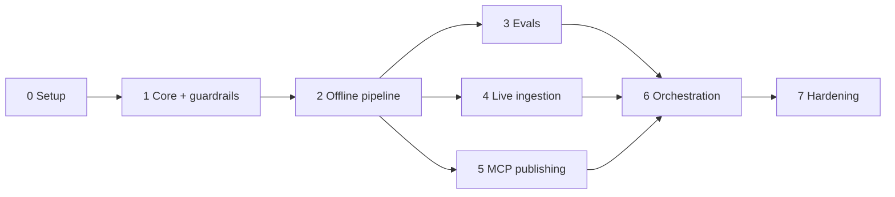

# Implementation Plan: Groww Weekly Review Pulse

This plan breaks the build into phases. Each phase ends with something runnable and a clear exit check. Requirements come from [problemStatement.md](problemStatement.md); the design comes from [architecture.md](architecture.md) (section numbers like "4.6" refer to it).

**Scope:** Google Play reviews only (Apple App Store is deferred). Google Docs and Gmail are reached through MCP only.

## External Dependency: Google Workspace MCP Server

Docs and Gmail are both served by one MCP server, used as-is and not modified or vendored into this repo.

| | |
| --- | --- |
| Repository | <https://github.com/saksham20189575/mcp-server-4> (MIT, TypeScript) |
| Pinned commit | `203fa75354fe7bd253534ca4703d8c0998414a7b` (`main`, 2026-09-03). Re-verify the tool list if you move off this commit. |
| Requires | Node.js 20+, a Google Cloud project with the Gmail API and Google Docs API enabled, OAuth 2.0 client credentials |
| Transport | `stdio` (default). Our Python MCP client launches it as a subprocess: `node <server_dir>/dist/index.js` |
| Auth | The server owns OAuth (`npm run auth`, tokens in its own `tokens.json`). This repo holds no Google credentials. |
| Scopes | `gmail.compose`, `documents` |

**Tools the server exposes, and how we use them**

| Server tool | Input (summary) | Use here |
| --- | --- | --- |
| `gmail_create_draft` | `to[]`, `subject`, `body`, `bodyType` (`text`/`html`), optional `cc[]`, `bcc[]` | **Used.** Creates the weekly draft. Returns `draftId`, `threadId`. |
| `google_docs_append_content` | `documentId`, `content`, optional `tabId`, `ensureLeadingNewline` | **Used.** Appends the weekly note to a pre-created Doc. Returns `documentId`, `charactersAppended`, `revisionId`. |
| `gmail_send_email` | same as draft | **Never called.** Sends immediately. Blocked by our client allowlist. |

**What the server cannot do, and the consequences for our design**

- **It cannot create a Google Doc.** A Doc must exist beforehand, and its `documentId` goes in config. This changes the Phase 0 "one doc per week" decision to **one rolling Doc with a section appended per week**; see Phase 0 task 5. The note's first line (`Groww Weekly Review Pulse - <YYYY-Www>`) serves as the section heading.
- **It cannot read a Doc or update a draft.** There is no read-back verification and no in-place update. A rerun cannot "update"; it must be prevented from appending or drafting twice, using a local ledger (Phase 6, task 3).
- **It returns no URLs.** We build the Doc link ourselves: `https://docs.google.com/document/d/<documentId>/edit`.
- **Append is not idempotent and draft creation is not idempotent.** Duplicate protection is entirely our responsibility.

**Launching it.** The server loads a `.env` from its working directory (dotenv), so our client starts it with `cwd` set to the server directory. Google secrets then stay in the server's `.env` and `tokens.json` (both gitignored upstream) and never enter this repo.

## Phase Overview

| Phase | Name | Outcome | Needs network / secrets? |
| --- | --- | --- | --- |
| 0 | Project setup and decisions | Repo skeleton, config, open questions resolved | No |
| 1 | Core domain and guardrails | Models, sanitizer, validator, with unit tests | No |
| 2 | Offline pipeline on fixture data | Theme, rank, compose, validate, render, end to end from a CSV | LLM key |
| 3 | Evals | Deterministic and golden-set evals, baseline recorded | LLM key |
| 4 | Live Play Store ingestion | Real reviews from the last 8-12 weeks | Network |
| 5 | MCP publishing | Pulse appended to the Google Doc, draft in Gmail (via mcp-server-4) | MCP server + Google auth |
| 6 | Orchestration, idempotency, scheduling | One command, safe to rerun, weekly trigger | MCP + LLM |
| 7 | Hardening and handover | Failure drills, docs, final acceptance run | All |

Phases 3, 4 and 5 are independent once Phase 2 is done and can run in parallel or in any order.

---

## Phase 0: Project Setup and Decisions

**Goal:** a runnable skeleton and every blocking decision made before code depends on it.

**Tasks**

1. Create the layout from architecture section 10: `src/pulse/`, `prompts/`, `evals/`, `tests/`, `data/` (git-ignored), `config.yaml`.
2. Set up Python project tooling: `pyproject.toml`, virtual environment, test runner (pytest), linter/formatter, `.gitignore` (must cover `data/`, `.env`), `.env.example` with `ANTHROPIC_API_KEY`.
3. Initialize git and make the first commit.
4. Write `config.yaml` with the settings from architecture section 9 (`app.play_package`, `window_weeks`, `max_themes`, ranking weights, model ids, `draft_to`).
5. Resolve the open questions in architecture section 13 that block later phases:
   - **Play Store access method** (live fetch vs. exported file) before Phase 4. *Decided: public fetch, CSV fallback.*
   - **Which Docs and Gmail MCP server** to use before Phase 5. *Decided: [saksham20189575/mcp-server-4](https://github.com/saksham20189575/mcp-server-4), pinned commit above.*
   - **One doc per week vs. one rolling doc** before Phase 5. *Originally decided: one doc per week. **Changed and confirmed:** the chosen server cannot create Docs, so the plan uses one pre-created rolling Doc with a section appended per week.*
   - **Draft recipient** (own address or alias) before Phase 5. *Decided: `prachtitest09@gmail.com`.*
6. Set up the MCP server and smoke-test it (no pipeline code yet):
   1. Clone it outside this repo and check out the pinned commit: `git clone https://github.com/saksham20189575/mcp-server-4 && cd mcp-server-4 && git checkout 203fa75`.
   2. Confirm Node.js 20+, then `npm install` and `npm run build`.
   3. In Google Cloud: enable the Gmail API and Google Docs API, configure the OAuth consent screen (add the sending account as a test user if the app is in testing mode), create an OAuth client with redirect URI `http://localhost:3000/oauth/callback`.
   4. `cp .env.example .env` and fill in `GOOGLE_CLIENT_ID`, `GOOGLE_CLIENT_SECRET`, `GOOGLE_REDIRECT_URI`. Keep `MCP_TRANSPORT=stdio`.
   5. Authorize once with `npm run auth` (or `npm run auth -- --callback-server`). Tokens are written to the server's `tokens.json`.
   6. Create the pulse Google Doc by hand (title e.g. `Groww Weekly Pulse`) in the authorized account and copy its `documentId` from the URL.
   7. Record in `config.yaml`: the server directory, the `documentId`, and the tool names from the table in "External Dependency".
   8. Run the smoke test with the MCP client (a throwaway script is fine): start the server over stdio, run `tools/list`, and confirm the three tools appear.
   9. Once, by hand, call `gmail_create_draft` to `draft_to` and `google_docs_append_content` with a short marker line, and confirm both show up in Gmail and the Doc. Delete the marker line and the test draft afterwards.

**Deliverables:** skeleton repo, `config.yaml`, decisions recorded in architecture section 13, a working local MCP server and a Doc ready to receive notes.

**Exit check:** `pytest` runs (even with zero tests), config loads, and the MCP server's `tools/list` returns `gmail_create_draft`, `gmail_send_email` and `google_docs_append_content` in the smoke test.

**Risk:** Google Cloud and OAuth friction (consent screen, test users, scopes) is the most likely blocker; surface it now rather than in Phase 5. The server repo is third-party and unpinned upstream, so stay on the pinned commit.

---

## Phase 1: Core Domain and Guardrails

**Goal:** the parts that enforce the problem statement's constraints, built first and tested without network or LLM.

**Tasks**

1. `models.py`: `RawReview`, `Review` (no author fields), `Theme`, `ThemeAssignment`, `Quote`, `Action`, `ThemeSummary`, `Pulse`, `Run` (architecture section 5).
2. `sanitize.py` (4.2):
   - Build `Review` from `RawReview` by omitting identity fields.
   - Scrub emails, phone numbers, URLs, long digit runs, ID-like strings to `[redacted]`.
   - Dedupe, drop empty or too-short reviews, language filter.
   - Anonymous `review_id` from a salted hash.
3. `validate.py` (4.6): theme cap, exactly 3 themes/quotes/actions, verbatim quote check (whitespace and case normalized, substring of source review), `review_id` exists, word count ≤ 250, PII scan on rendered text, actions tied to top-3 themes. Return a structured list of violations.
4. `render.py`: the fixed one-page template (4.5) producing the Doc body and the email body from a `Pulse`.
5. Unit tests for every check, including the failure case for each (invented quote, 251-word note, seeded email/phone in text, 6 themes).

**Deliverables:** `models`, `sanitize`, `validate`, `render` with tests.

**Exit check:** all tests pass; a hand-built valid `Pulse` passes validation and a deliberately broken one reports the exact violation.

---

## Phase 2: Offline Pipeline on Fixture Data

**Goal:** the full analysis path (reviews in, validated pulse out) with no live store or Google access.

**Tasks**

1. `sources/csv_source.py`: the `ReviewSource` interface and `CsvSource` (4.1).
2. Build a fixture set under `evals/fixtures/`: a few hundred anonymized Groww-style reviews across 8-12 weeks, covering KYC, payments/withdrawals, app performance, statements, support, plus seeded PII and a prompt-injection review. Use real public reviews or a hand-written realistic set; strip all identifying data.
3. `llm.py`: Groq client wrapper with schema-validated JSON output, bounded retries, model ids from config, no key logging.
4. Prompts under `prompts/` (versioned): `theme_assign.md`, `compose.md`. Review text goes in delimited data blocks.
5. `theming.py` (4.3): batched assignment against the seed taxonomy, consolidation to at most 5 themes enforced in code, assignment cache keyed by `(review_id, taxonomy_hash)`.
6. `ranking.py` (4.4): score = volume + recency + severity, with components returned for the run record.
7. `compose.py` (4.5): code selects quote candidates, the LLM picks and trims, then validation. Three action ideas grounded in the top themes. Retry up to 2 times with violation feedback.
8. A dry-run CLI: `python -m pulse run --source csv --dry-run` writes the rendered note to `data/runs/<run_id>/`.

**Deliverables:** working end-to-end dry run on fixtures.

**Exit check:** the dry run produces a note that passes every guardrail: ≤ 5 themes, 3 themes, 3 verbatim quotes, 3 actions, ≤ 250 words, no PII. The injection review does not alter the output structure. Reading the note, the themes and actions are sensible for the fixture data.

---

## Phase 3: Evals

**Goal:** measure quality and regressions rather than judging by eye (the course track is "AI Workflows, Agents and Evals").

**Tasks**

1. Deterministic eval suite (8.1): runs the guardrail assertions over pipeline outputs. Quote verbatim rate must be 100%.
2. Hand-label themes for the fixture set; implement the theme-agreement metric (8.2).
3. Golden-set evals (8.2): theme cap, quote fidelity, seeded-PII leakage, prompt-injection resistance, action groundedness, length.
4. LLM-as-judge rubric in `prompts/judge.md` (actionability, faithfulness, scannability). Advisory only.
5. `evals/run_golden.py`: one command, tabular report, results saved per prompt version.
6. Record a **baseline** and set the theme-agreement threshold (architecture open question 5).
7. Optional: wire the deterministic suite into CI.

**Deliverables:** eval suite, baseline report, thresholds.

**Exit check:** the suite passes at baseline, and a deliberately degraded prompt makes at least one eval fail (proves the evals can catch regressions).

---

## Phase 4: Live Play Store Ingestion

**Goal:** real reviews for the last 8-12 weeks, within the "public data only" rule.

**Tasks**

1. Implement `PlayStoreSource` (4.1) using the access method chosen in Phase 0, for `com.nextbillion.groww`, `hl=en_IN`.
2. Window filter (`window_weeks`, 8-12), pagination, polite delays, bounded retries with backoff.
3. Normalize to `RawReview` immediately; no store-specific fields beyond that layer.
4. Cache responses in `data/raw/<run_id>/`, minimized to the fields the pipeline needs, and never read by later stages.
5. Handle edge cases: empty window, very large volume, non-English reviews, missing fields.
6. Tests with recorded responses (no live calls in the test suite).
7. Fallback path: if live fetch fails or is not allowed, ingest a Play Console export through `CsvSource`.

**Deliverables:** `PlayStoreSource`, cached live run.

**Exit check:** a dry run on live data produces a note passing all guardrails. Sanitization logs show reviewer identity fields never reach the sanitized output, and the date range of fetched reviews matches the configured window.

---

## Phase 5: MCP Publishing (Docs and Gmail)

**Goal:** put the pulse in Google Docs and create a Gmail draft through the Google Workspace MCP server (see "External Dependency"), with no Google SDK or OAuth code in this repo.

**Tasks**

1. `mcp/client.py` (7): an MCP client (official Python `mcp` SDK, stdio transport) that launches the server with `command: node`, `args: [<server_dir>/dist/index.js]`, `cwd: <server_dir>` so the server reads its own `.env`. It lists tools, calls tools, and enforces the **allowlist**: only `gmail_create_draft` and `google_docs_append_content` are callable. `gmail_send_email` is **not** allowlisted, so the agent cannot send mail even though the server offers it. Fail at startup if the server's `tools/list` is missing either allowed tool.
2. Tool-mapping adapter, from our logical operations to the server's real names and argument shapes:

   | Logical operation | Server tool | Arguments we send |
   | --- | --- | --- |
   | `append_to_document` | `google_docs_append_content` | `documentId` (from config), `content` (the note), `ensureLeadingNewline: true` |
   | `create_draft` | `gmail_create_draft` | `to: [draft_to]`, `subject`, `body`, `bodyType: "text"` |

   There is no logical `create_document`, `get_document` or `update_draft`; the server has none.
3. `mcp/docs.py` (4.7): append the rendered note to the configured Doc, preceded by a blank-line separator so each week reads as its own section. Verify the response: `charactersAppended` must equal the length of the content sent, and `documentId` must match. Record `revisionId` in the run record. No read-back is possible. Build the Doc link as `https://docs.google.com/document/d/<documentId>/edit`.
4. `mcp/gmail.py` (4.8): create a draft to `draft_to` with subject `Groww Weekly Review Pulse - <week_label>`, body = note plus Doc link, falling back to the three themes plus link if too long. Respect the server's `MAX_EMAIL_BODY_BYTES` (default 1 MiB), which is far above our size, and check `status == "draft_created"` in the response.
5. Error classification using the server's error envelope: retryable (timeout, transient Google errors) vs. fatal (`GOOGLE_AUTH_REQUIRED` and `INSUFFICIENT_SCOPE` with a message telling the user to run `npm run auth` in the server directory; `DOC_PERMISSION_DENIED` naming the account that needs edit access; `INVALID_INPUT`, `PAYLOAD_TOO_LARGE`). Never retry an append or draft call blindly after an ambiguous failure (see Phase 6, task 3).
6. Tests: unit tests against a fake MCP server that implements the three tools' schemas (including a test that `gmail_send_email` is rejected by the allowlist), and an opt-in integration test (`RUN_INTEGRATION_TESTS=1`) against the real server and account using a dummy pulse.
7. `--dry-run` skips both MCP calls.

**Deliverables:** Docs appender and Gmail drafter.

**Exit check:** a dummy pulse appears as a new section in the configured Google Doc and as an unsent Gmail draft addressed to `draft_to`. A test proves the allowlist rejects `gmail_send_email`, and no production code path calls it.

---

## Phase 6: Orchestration, Idempotency, Scheduling

**Goal:** one command runs the whole workflow and is safe to run again.

**Tasks**

1. `orchestrator.py` (4.9): run stages 1-9, persist each stage's output to `data/runs/<run_id>/<stage>.json`, support `--resume` from any stage.
2. Run record (observability section 11): stage timings, counts after fetch/dedupe/theme, per-theme score components, prompt versions, retries, validation outcome, `doc_id`, `draft_id`.
3. Idempotency (4.7, 4.8): the server can neither update a draft nor read a Doc, so reruns are prevented from duplicating output by a local **ledger** (`data/ledger.json`, git-ignored) keyed by `week_label`:
   - `doc`: `pending` | `appended` (with `revisionId`, `charactersAppended`)
   - `draft`: `pending` | `created` (with `draftId`)
   - Write `pending` **before** each MCP call and the final state **immediately after**. A rerun skips any step already `appended` / `created`.
   - If a step is left `pending` (the process died mid-call), the outcome is ambiguous: the rerun stops and asks the user to check the Doc / Drafts folder and clear the ledger entry by hand, rather than risk a duplicate.
   - Losing the ledger loses duplicate protection; the README must say so.
4. Failure statuses from architecture section 11: `failed_validation` publishes nothing, `partial` (note appended to the Doc, draft failed) allows retrying only the draft stage.
5. CLI: `python -m pulse run --week current [--dry-run] [--resume <run_id>]`.
6. Scheduling (4.10): document and set up an external weekly trigger (cron, Windows Task Scheduler, or a CI schedule) that calls the CLI.

**Deliverables:** single-command pipeline, run records, scheduled trigger.

**Exit check:** two consecutive runs for the same week leave exactly one appended section in the Doc and one draft. A run killed mid-way resumes without redoing completed stages, and one killed between an MCP call and its ledger write is refused with the "check manually" message instead of duplicating.

---

## Phase 7: Hardening and Handover

**Goal:** confidence that the system behaves under failure and that someone else can run it.

**Tasks**

1. Failure drills, one per row of the error-handling table (architecture section 11): source down, too few reviews, invalid LLM output, validation failure after retries, Docs MCP down, Gmail MCP down after Doc success. Add MCP-server-specific drills: expired or revoked Google token (`GOOGLE_AUTH_REQUIRED`), Doc not shared with the authorized account (`DOC_PERMISSION_DENIED`), server binary missing or not built, and a kill between an MCP call and its ledger write. Confirm each ends in the specified state.
2. Privacy audit: search the run directory, Doc, and draft for names, emails, phone numbers and long digit strings from the raw data; confirm none appear.
3. Security review of the agent: confirm the API key is never logged, review text never triggers tool calls, the MCP allowlist is enforced and `gmail_send_email` is unreachable, and no Google credentials or `tokens.json` are in this repo or its logs. Note that the `documents` OAuth scope can edit any Doc the account can access, so confirm the agent only ever passes the configured `documentId`.
4. Cost and latency check on a full 12-week run; tune batch sizes and model choices if needed.
5. Documentation: a README (setup, config, MCP server setup per Phase 0 task 6 including Google Cloud and `npm run auth`, how to re-authorize when the token expires, the ledger and what losing it means, how to run, how to read a run record, how to run evals) and any changes back-ported into architecture.md.
6. **Final acceptance run** against the problem statement (checklist below).

**Deliverables:** README, audit results, accepted final run.

**Exit check:** every item in the acceptance checklist passes.

---

## Acceptance Checklist (from the problem statement)

- [ ] Reviews come from Google Play, from roughly the last 8-12 weeks, via public data only
- [ ] At most 5 themes in clustering; the note highlights the top 3
- [ ] 3 user quotes, each found verbatim in a source review
- [ ] 3 action ideas, each grounded in a top-3 theme
- [ ] Note is one page and ≤ 250 words
- [ ] No usernames, emails, device IDs, or other reviewer identifiers in any artifact
- [ ] Pulse is in a Google Doc, written through the Google Workspace MCP server (`google_docs_append_content`)
- [ ] A Gmail draft to self or an alias contains the note or a clear pointer to it, created through the same server (`gmail_create_draft`); nothing is sent
- [ ] No direct Google API, OAuth client, or REST code in the repo
- [ ] Rerunning the same week does not append a second section or create a second draft

## Cross-Phase Notes

- **Test first for constraints.** Phase 1 comes before any LLM work so the problem statement's rules are code before they are prompts.
- **Keep dry-run working at every phase.** It is the safe way to iterate without touching Google.
- **The MCP server is a pinned third-party dependency.** Stay on the commit in "External Dependency"; if it is upgraded, re-run the Phase 0 smoke test and the Phase 5 integration test before trusting it. Never modify it from this project.
- **Stage the Google side by hand first.** Phase 0 proves the server, auth, and Doc work manually, so any Phase 5 failure is ours and not the environment's.
- **Prompt changes need an eval run.** From Phase 3 on, any change to a prompt or model id is checked against the golden set before it is merged.
- **Deferred:** Apple App Store ingestion. When picked up, it is a new `ReviewSource` implementation plus a config entry; no other phase needs rework.
