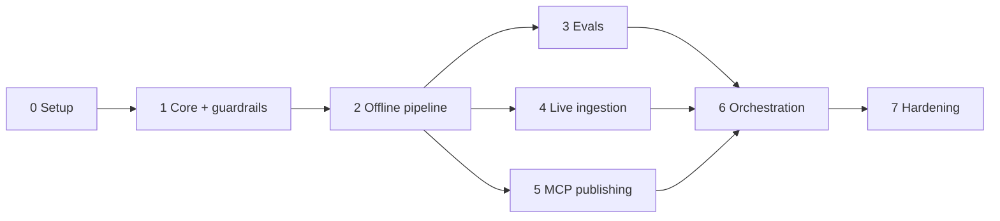

# Implementation Plan: Groww Weekly Review Pulse

This plan breaks the build into phases. Each phase ends with something runnable and a clear exit check. Requirements come from [problemStatement.md](problemStatement.md); the design comes from [architecture.md](architecture.md) (section numbers like "4.6" refer to it).

**Scope:** Google Play reviews only (Apple App Store is deferred). Google Docs and Gmail are reached through MCP only.

## Phase Overview

| Phase | Name | Outcome | Needs network / secrets? |
| --- | --- | --- | --- |
| 0 | Project setup and decisions | Repo skeleton, config, open questions resolved | No |
| 1 | Core domain and guardrails | Models, sanitizer, validator, with unit tests | No |
| 2 | Offline pipeline on fixture data | Theme, rank, compose, validate, render, end to end from a CSV | LLM key |
| 3 | Evals | Deterministic and golden-set evals, baseline recorded | LLM key |
| 4 | Live Play Store ingestion | Real reviews from the last 8-12 weeks | Network |
| 5 | MCP publishing | Pulse in Google Docs, draft in Gmail | MCP servers + Google auth |
| 6 | Orchestration, idempotency, scheduling | One command, safe to rerun, weekly trigger | MCP + LLM |
| 7 | Hardening and handover | Failure drills, docs, final acceptance run | All |

Phases 3, 4 and 5 are independent once Phase 2 is done and can run in parallel or in any order.

---

## Phase 0: Project Setup and Decisions

**Goal:** a runnable skeleton and every blocking decision made before code depends on it.

**Tasks**

1. Create the layout from architecture section 10: `src/pulse/`, `prompts/`, `evals/`, `tests/`, `data/` (git-ignored), `config.yaml`.
2. Set up Python project tooling: `pyproject.toml`, virtual environment, test runner (pytest), linter/formatter, `.gitignore` (must cover `data/`, `.env`), `.env.example` with `ANTHROPIC_API_KEY`.
3. Initialize git and make the first commit.
4. Write `config.yaml` with the settings from architecture section 9 (`app.play_package`, `window_weeks`, `max_themes`, ranking weights, model ids, `draft_to`).
5. Resolve the open questions in architecture section 13 that block later phases:
   - **Play Store access method** (live fetch vs. exported file) before Phase 4.
   - **Which Docs and Gmail MCP servers** to use before Phase 5.
   - **One doc per week vs. one rolling doc** before Phase 5.
   - **Draft recipient** (own address or alias) before Phase 5.
6. Confirm the MCP servers can be started locally and the Google account can be authorized (a smoke test, no pipeline code yet).

**Deliverables:** skeleton repo, `config.yaml`, decisions recorded in architecture section 13.

**Exit check:** `pytest` runs (even with zero tests), config loads, and an MCP server lists its tools in a manual smoke test.

**Risk:** MCP server availability or auth friction. Surface it now rather than in Phase 5.

---

## Phase 1: Core Domain and Guardrails

**Goal:** the parts that enforce the problem statement's constraints, built first and tested without network or LLM.

**Tasks**

1. `models.py`: `RawReview`, `Review` (no author fields), `Theme`, `ThemeAssignment`, `Quote`, `Action`, `ThemeSummary`, `Pulse`, `Run` (architecture section 5).
2. `sanitize.py` (4.2):
   - Build `Review` from `RawReview` by omitting identity fields.
   - Scrub emails, phone numbers, URLs, long digit runs, ID-like strings to `[redacted]`.
   - Dedupe, drop empty or too-short reviews, language filter.
   - Anonymous `review_id` from a salted hash.
3. `validate.py` (4.6): theme cap, exactly 3 themes/quotes/actions, verbatim quote check (whitespace and case normalized, substring of source review), `review_id` exists, word count ≤ 250, PII scan on rendered text, actions tied to top-3 themes. Return a structured list of violations.
4. `render.py`: the fixed one-page template (4.5) producing the Doc body and the email body from a `Pulse`.
5. Unit tests for every check, including the failure case for each (invented quote, 251-word note, seeded email/phone in text, 6 themes).

**Deliverables:** `models`, `sanitize`, `validate`, `render` with tests.

**Exit check:** all tests pass; a hand-built valid `Pulse` passes validation and a deliberately broken one reports the exact violation.

---

## Phase 2: Offline Pipeline on Fixture Data

**Goal:** the full analysis path (reviews in, validated pulse out) with no live store or Google access.

**Tasks**

1. `sources/csv_source.py`: the `ReviewSource` interface and `CsvSource` (4.1).
2. Build a fixture set under `evals/fixtures/`: a few hundred anonymized Groww-style reviews across 8-12 weeks, covering KYC, payments/withdrawals, app performance, statements, support, plus seeded PII and a prompt-injection review. Use real public reviews or a hand-written realistic set; strip all identifying data.
3. `llm.py`: Claude client wrapper with schema-validated JSON output, bounded retries, model ids from config, no key logging.
4. Prompts under `prompts/` (versioned): `theme_assign.md`, `compose.md`. Review text goes in delimited data blocks.
5. `theming.py` (4.3): batched assignment against the seed taxonomy, consolidation to at most 5 themes enforced in code, assignment cache keyed by `(review_id, taxonomy_hash)`.
6. `ranking.py` (4.4): score = volume + recency + severity, with components returned for the run record.
7. `compose.py` (4.5): code selects quote candidates, the LLM picks and trims, then validation. Three action ideas grounded in the top themes. Retry up to 2 times with violation feedback.
8. A dry-run CLI: `python -m pulse run --source csv --dry-run` writes the rendered note to `data/runs/<run_id>/`.

**Deliverables:** working end-to-end dry run on fixtures.

**Exit check:** the dry run produces a note that passes every guardrail: ≤ 5 themes, 3 themes, 3 verbatim quotes, 3 actions, ≤ 250 words, no PII. The injection review does not alter the output structure. Reading the note, the themes and actions are sensible for the fixture data.

---

## Phase 3: Evals

**Goal:** measure quality and regressions rather than judging by eye (the course track is "AI Workflows, Agents and Evals").

**Tasks**

1. Deterministic eval suite (8.1): runs the guardrail assertions over pipeline outputs. Quote verbatim rate must be 100%.
2. Hand-label themes for the fixture set; implement the theme-agreement metric (8.2).
3. Golden-set evals (8.2): theme cap, quote fidelity, seeded-PII leakage, prompt-injection resistance, action groundedness, length.
4. LLM-as-judge rubric in `prompts/judge.md` (actionability, faithfulness, scannability). Advisory only.
5. `evals/run_golden.py`: one command, tabular report, results saved per prompt version.
6. Record a **baseline** and set the theme-agreement threshold (architecture open question 5).
7. Optional: wire the deterministic suite into CI.

**Deliverables:** eval suite, baseline report, thresholds.

**Exit check:** the suite passes at baseline, and a deliberately degraded prompt makes at least one eval fail (proves the evals can catch regressions).

---

## Phase 4: Live Play Store Ingestion

**Goal:** real reviews for the last 8-12 weeks, within the "public data only" rule.

**Tasks**

1. Implement `PlayStoreSource` (4.1) using the access method chosen in Phase 0, for `com.nextbillion.groww`, `hl=en_IN`.
2. Window filter (`window_weeks`, 8-12), pagination, polite delays, bounded retries with backoff.
3. Normalize to `RawReview` immediately; no store-specific fields beyond that layer.
4. Cache responses in `data/raw/<run_id>/`, minimized to the fields the pipeline needs, and never read by later stages.
5. Handle edge cases: empty window, very large volume, non-English reviews, missing fields.
6. Tests with recorded responses (no live calls in the test suite).
7. Fallback path: if live fetch fails or is not allowed, ingest a Play Console export through `CsvSource`.

**Deliverables:** `PlayStoreSource`, cached live run.

**Exit check:** a dry run on live data produces a note passing all guardrails. Sanitization logs show reviewer identity fields never reach the sanitized output, and the date range of fetched reviews matches the configured window.

---

## Phase 5: MCP Publishing (Docs and Gmail)

**Goal:** put the pulse in Google Docs and create a Gmail draft, with no Google SDK or OAuth code in this repo.

**Tasks**

1. `mcp/client.py` (7): connect to configured MCP servers, list tools, call tools, enforce the **allowlist** (create/update document, read document, create/update draft; no send, no delete, no share).
2. Tool-mapping adapter: map logical operations to the real tool names and argument shapes of the chosen servers.
3. `mcp/docs.py` (4.7): create or update the pulse document titled `Groww Weekly Pulse - <YYYY-Www>`, read it back, verify quotes and word count survived formatting.
4. `mcp/gmail.py` (4.8): create a draft to `draft_to` with subject `Groww Weekly Review Pulse - <week_label>`, body = note plus Doc link, falling back to the three themes plus link if too long.
5. Error classification: retryable (timeout, transient) vs. fatal (auth missing), with a clear re-authorization message.
6. Integration test against a real account using a dummy pulse, and unit tests against a fake MCP server.
7. `--dry-run` skips both MCP calls.

**Deliverables:** Docs publisher and Gmail drafter.

**Exit check:** a dummy pulse appears as a Google Doc and as an unsent Gmail draft in the user's mailbox. Inspecting the allowlist confirms there is no send operation.

---

## Phase 6: Orchestration, Idempotency, Scheduling

**Goal:** one command runs the whole workflow and is safe to run again.

**Tasks**

1. `orchestrator.py` (4.9): run stages 1-9, persist each stage's output to `data/runs/<run_id>/<stage>.json`, support `--resume` from any stage.
2. Run record (observability section 11): stage timings, counts after fetch/dedupe/theme, per-theme score components, prompt versions, retries, validation outcome, `doc_id`, `draft_id`.
3. Idempotency (4.7, 4.8): store `week_label -> doc_id` and `week_label -> draft_id`; a rerun for the same week updates instead of duplicating.
4. Failure statuses from architecture section 11: `failed_validation` publishes nothing, `partial` (Doc created, draft failed) allows retrying only the draft stage.
5. CLI: `python -m pulse run --week current [--dry-run] [--resume <run_id>]`.
6. Scheduling (4.10): document and set up an external weekly trigger (cron, Windows Task Scheduler, or a CI schedule) that calls the CLI.

**Deliverables:** single-command pipeline, run records, scheduled trigger.

**Exit check:** two consecutive runs for the same week leave exactly one Doc and one draft. A run killed mid-way resumes without redoing completed stages.

---

## Phase 7: Hardening and Handover

**Goal:** confidence that the system behaves under failure and that someone else can run it.

**Tasks**

1. Failure drills, one per row of the error-handling table (architecture section 11): source down, too few reviews, invalid LLM output, validation failure after retries, Docs MCP down, Gmail MCP down after Doc success. Confirm each ends in the specified state.
2. Privacy audit: search the run directory, Doc, and draft for names, emails, phone numbers and long digit strings from the raw data; confirm none appear.
3. Security review of the agent: confirm the API key is never logged, review text never triggers tool calls, the MCP allowlist is enforced.
4. Cost and latency check on a full 12-week run; tune batch sizes and model choices if needed.
5. Documentation: a README (setup, config, MCP server setup, how to run, how to read a run record, how to run evals) and any changes back-ported into architecture.md.
6. **Final acceptance run** against the problem statement (checklist below).

**Deliverables:** README, audit results, accepted final run.

**Exit check:** every item in the acceptance checklist passes.

---

## Acceptance Checklist (from the problem statement)

- [ ] Reviews come from Google Play, from roughly the last 8-12 weeks, via public data only
- [ ] At most 5 themes in clustering; the note highlights the top 3
- [ ] 3 user quotes, each found verbatim in a source review
- [ ] 3 action ideas, each grounded in a top-3 theme
- [ ] Note is one page and ≤ 250 words
- [ ] No usernames, emails, device IDs, or other reviewer identifiers in any artifact
- [ ] Pulse is in a Google Doc, written through a Docs MCP server
- [ ] A Gmail draft to self or an alias contains the note or a clear pointer to it, created through a Gmail MCP server
- [ ] No direct Google API, OAuth client, or REST code in the repo
- [ ] Rerunning the same week does not duplicate the Doc or the draft

## Cross-Phase Notes

- **Test first for constraints.** Phase 1 comes before any LLM work so the problem statement's rules are code before they are prompts.
- **Keep dry-run working at every phase.** It is the safe way to iterate without touching Google.
- **Prompt changes need an eval run.** From Phase 3 on, any change to a prompt or model id is checked against the golden set before it is merged.
- **Deferred:** Apple App Store ingestion. When picked up, it is a new `ReviewSource` implementation plus a config entry; no other phase needs rework.
